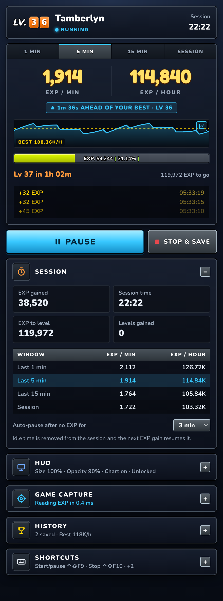
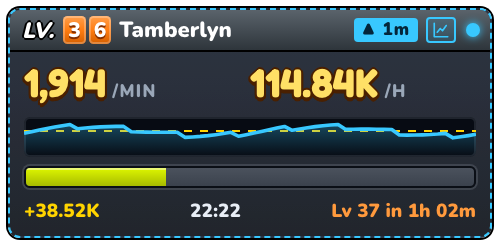

# Classic EXP Tracker

A native desktop app for **MapleStory Classic** that tells you how well you are training: **EXP per minute and per hour**, live, while you play.

It only reads the game's status bar from the screen. It never reads or writes game memory, never sends input to the game and never draws inside the game window.

<p align="center">
  
  &nbsp;&nbsp;
  
</p>

<p align="center"><sub>Main window (left) and the compact HUD at 200% (right). Screenshots use sample data.</sub></p>

## Features

**EXP rate**
- EXP/min and EXP/h always visible, for the window you pick: last 1 min, 5 min, 15 min or the whole session.
- Rate chart for the last 30 active minutes, with your best session as a reference line. It can be hidden.
- Time to next level (`Lv 37 in 1h 02m`) and EXP left to level.
- Feed of the latest EXP gains with their time.
- Correct accounting across level-ups using the built-in Classic EXP table (levels 1–99).

**Pace against your best**
- Compares the live session with your best saved session at the same level: `▲ 1m 36s ahead` or `▼ 2m 10s behind`.

**Sessions**
- Manual start, pause and stop; each stopped session is saved locally with its EXP, time and levels.
- Optional idle auto-pause (2–10 min without EXP): the idle stretch is removed from the session so AFK time never lowers your rate, and the next EXP gain resumes it.
- History of recent sessions with their EXP/h.

**Compact HUD**
- Small always-on-top window to keep next to or over the game window.
- Shows rates, pace vs best, chart, EXP bar, session time and time to level.
- Size from 100% to 200% and background opacity from 30% to 100%.
- Lock it (click-through) or unlock it to drag it and use its pause, stop and chart buttons.
- Level-up flash and an AFK state when auto-paused.

**Global hotkeys**
- Start/pause, stop & save, show/hide HUD and lock/unlock HUD, default `Ctrl+Shift+F9..F12`.
- Every hotkey can be rebound from the app; combos that would steal game keys or clash with another app are rejected.

**Screen reading**
- Finds the game window by itself and reads only the status bar region.
- Custom glyph-template OCR for the EXP line and level: about 20 µs per read, once per second, skipped when the frame did not change.
- Reads the character name and level once at startup with the OS text recognizer (Apple Vision / Windows OCR).
- Learns unknown digit shapes on its own and rejects implausible reads.

**Privacy**
- Everything stays on your machine: settings in a JSON file, sessions in a local SQLite database. No account, no network calls.

## How it works

```
game window ──capture──▶ status bar crop ──glyph OCR──▶ EXP reading ──▶ session + rates ──▶ main window / HUD
                                                                          └──▶ SQLite (on stop)
```

Details, decisions and the full spec are in [docs/base_context.md](docs/base_context.md).

## Platforms

- **macOS:** works with the Classic client in windowed mode. Needs Screen Recording permission for the app.
- **Windows:** builds and uses Windows Graphics Capture and Windows OCR; not yet tested on a real Windows machine.

## Tech

Rust (Cargo workspace) · Tauri v2 · Svelte 5 · SQLite (`rusqlite`) · `xcap` for window capture.

| Path | Content |
|---|---|
| `crates/exp-core` | Platform-independent logic: EXP accounting, reading validation, rolling rates, sessions, EXP table |
| `crates/capture` | Game window lookup and capture, region crop, frame hash, screen permission |
| `crates/ocr` | Status bar OCR: label search, glyph templates, parsing, self-learning |
| `crates/sysocr` | OS text recognition for the character name |
| `src-tauri` | Desktop app: windows, hotkeys, commands, settings, SQLite storage |
| `src` | Svelte frontend: main window (`/`) and HUD (`/hud`) |
| `docs` | Spec and screenshots |

## Development

Requirements:
- Rust (stable, edition 2024)
- Node.js 22+ and pnpm
- macOS: Xcode Command Line Tools
- Windows: Microsoft C++ Build Tools and WebView2 (preinstalled on Windows 10/11)

```bash
pnpm install            # install frontend dependencies
pnpm tauri dev          # run the app in development mode
pnpm dev                # UI-only preview in a browser with sample data (http://127.0.0.1:1420)
pnpm tauri build        # build the release executable and installers
cargo test --workspace  # run Rust tests
pnpm check              # type-check the Svelte frontend
```

macOS only:

```bash
pnpm app:mac            # build and open a signed debug .app that owns its Screen Recording permission
pnpm fix:signing        # once: stop keychain password prompts when signing
```

`pnpm app:mac` signs with the identity in `APPLE_SIGNING_IDENTITY` from an untracked `.env.local` (see `.env.example`). A stable identity keeps the Screen Recording permission across rebuilds.

## Disclaimer

Independent fan project, not affiliated with or endorsed by Nexon. MapleStory is a trademark of Nexon. The app only reads pixels that are already on your screen.
